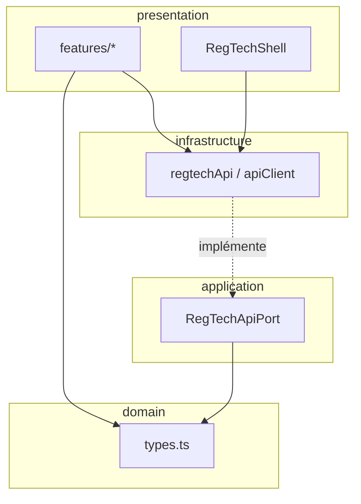
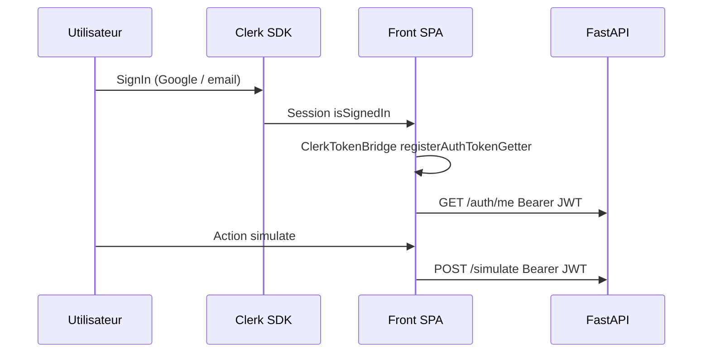

# RegTech Front-End — Présentation technique  
## Jury : développeur senior

| Projet | RegTech — Assistant douanier AfCFTA |
|--------|-------------------------------------|
| Équipe | EAGLES — Hackathon J.U.I.N 2026 |
| Dossier | `Front-End/` |
| Durée oral recommandée | **8–12 minutes** + questions |
| Références | [ADR-002](../../docs/decisions/002-frontend-clean-architecture.md), [ADR-007](../../docs/decisions/007-api-rest-versionnee.md), [ADR-008](../../docs/decisions/008-authentification-clerk.md) |

---

# 1. Objectif de cette présentation

Montrer au jury technique que le Front-End n’est pas un prototype JSX monolithique, mais une **SPA structurée** qui :

1. **Sépare** UI, contrat API et types métier.
2. **Délègue** tout calcul tarifaire et classification au Back (pas de logique fiscale durable côté client).
3. **Sécurise** les parcours métier via Clerk + JWT Bearer.
4. **Supporte** les contraintes hackathon : réseau instable, listes longues (pays/HS), thème clair/sombre, responsive.

---

# 2. Stack et outillage

| Couche | Choix | Justification |
|--------|-------|---------------|
| UI | **React 19** | Composants, hooks, écosystème mature |
| Build | **Vite 6** | HMR rapide, ESM natif, proxy dev `/api` |
| Langage | **TypeScript 5.8** (`strict: true`) | Contrats API typés, erreurs à la compilation |
| Styles | **Tailwind CSS 4** (`@tailwindcss/vite`) | Design system cohérent, dark mode via classes |
| Icônes | **lucide-react** | Tree-shaking, accessibilité |
| Auth | **@clerk/react** + **@clerk/themes** | OAuth/session sans implémentation maison |
| Excel | **xlsx** (import dynamique) | Chunk séparé, chargé seulement à l’import lot |
| Alias | `@/*` → `src/*` | Imports stables (`tsconfig` paths) |

**Scripts :**

```bash
npm run dev      # Vite, port 3000, proxy → localhost:8000
npm run build    # tsc --noEmit && vite build
npm run lint     # tsc --noEmit
```

**Variables d’environnement :**

| Variable | Rôle |
|----------|------|
| `VITE_CLERK_PUBLISHABLE_KEY` | Obligatoire — ClerkProvider |
| `VITE_PROXY_TARGET` | Cible API en dev (défaut `http://localhost:8000`) |
| `VITE_API_BASE_URL` | Vide en dev → même origine + proxy Vite |

---

# 3. Architecture — Clean Architecture (ADR-002)

## 3.1 Arborescence réelle

```
Front-End/src/
├── main.tsx                          # Point d'entrée, arbre de providers
├── index.css                         # Tailwind + polices + animations logo
│
├── domain/
│   └── reference/
│       ├── types.ts                  # Country, HSProduct, SimulationResult…
│       ├── afcftaSchedules.ts        # Calendrier ZLECAf (seul référentiel statique UI)
│       ├── currencyUtils.ts          # Helpers affichage devises
│       └── regtechData.ts            # Legacy / fallback local
│
├── application/
│   └── ports/
│       └── RegTechApiPort.ts         # Interface contrat API (cible use-cases)
│
├── infrastructure/
│   └── http/
│       ├── apiClient.ts              # fetch + Bearer + ApiError + timeouts
│       ├── authToken.ts              # Injection getToken() Clerk
│       ├── regtechApi.ts             # Façade /api/v1 + cache mémoire
│       └── countriesMapper.ts        # DTO Back → domain Country
│
└── presentation/
    ├── layout/
    │   └── RegTechShell.tsx          # Shell : sidebar, onglets, compare, historique
    ├── features/
    │   ├── tariff-calculator/SimulateurTaxes.tsx
    │   ├── classification/IntelligentClassifier.tsx
    │   └── export/                   # BatchLoader, DeclarationSummary, MetricsChart
    ├── components/
    │   ├── auth/                     # AuthGate, ClerkSignInPage, UserButton
    │   ├── shared/                   # SearchableSelect, ApiStatusBanner
    │   └── brand/DynamicLogo.tsx
    └── providers/
        ├── ThemeProvider.tsx
        ├── ClerkProviderWithTheme.tsx
        ├── ClerkTokenBridge.tsx
        └── ReferenceDataProvider.tsx
```

## 3.2 Règle de dépendance



| Couche | Autorisé | Interdit |
|--------|----------|----------|
| `domain` | Types, constantes calendrier | `fetch`, React, Clerk |
| `application` | Ports, (futurs use-cases) | JSX, implémentation HTTP |
| `infrastructure` | HTTP, mapping DTO | Composants UI |
| `presentation` | React, état local UI, providers | Formules tarifaires autoritatives |

**État actuel (transparence jury) :** les features appellent encore **`regtechApi` directement** plutôt que des use-cases via `RegTechApiPort`. Le port existe ; `application/use-cases/` est prévu (dossier `.gitkeep`). Migration = refactor mécanique sans changer l’UX.

---

# 4. Bootstrap applicatif (`main.tsx`)

Ordre des providers (extérieur → intérieur) :

```
StrictMode
└── ThemeProvider                    # dark/light, localStorage regtech-theme
    └── ClerkProviderWithTheme       # Clerk + appearance thème RegTech
        └── ReferenceDataProvider    # pays + produits HS (API publique)
            └── ClerkTokenBridge     # register getToken + syncProfile
                └── AuthGate         # SignIn ou enfants authentifiés
                    └── RegTechShell
```

**Décisions visibles dans le code :**

- Pas de clé Clerk → écran `MissingClerkConfig` (fail-fast config).
- `AuthGate` : spinner tant que `isLoaded`, puis `ClerkSignInPage` ou app.
- Référentiels chargés **avant** le shell (évite flash de listes vides si API OK).

---

# 5. Authentification Front (ADR-008)

## 5.1 Flux



## 5.2 Fichiers clés

| Fichier | Responsabilité |
|---------|----------------|
| `ClerkProviderWithTheme.tsx` | `ClerkProvider` + `clerkAppearance(darkMode)` |
| `clerkAppearance.ts` | Thème RegTech (slate/emerald) SignIn + UserButton |
| `AuthGate.tsx` | Garde : non connecté → plein écran SignIn |
| `ClerkTokenBridge.tsx` | `registerAuthTokenGetter(() => getToken())` |
| `authToken.ts` | Singleton getter injecté (découple apiClient de Clerk) |
| `ClerkAuthButton.tsx` | `UserButton` dans le header |
| `apiClient.ts` | Ajoute `Authorization: Bearer` si `authenticated: true` |

**Point fort à souligner :** `apiClient` ne importe **pas** `@clerk/react` — testabilité et couplage faible.

## 5.3 Routes API et auth

| Appel | `authenticated` | Comportement UI si 401 |
|-------|-----------------|------------------------|
| `GET /health`, `/countries`, `/tariffs` | `false` | Bandeau API hors ligne |
| `POST /simulate`, `/classify`, `/batch` | `true` (défaut POST) | Message `ApiError` français |
| `GET /history`, `/auth/me` | `true` | Historique vide / sync profil silencieux |

---

# 6. Couche HTTP — `apiClient` & `regtechApi`

## 6.1 `apiClient.ts`

- **`ApiError`** : classe dédiée avec `status` (401 → message session).
- **`AbortController`** : timeout GET 15 s, POST 60 s (batch 120 s).
- **Parsing erreur** : `detail` / `error` FastAPI Pydantic.
- **Base URL** : `VITE_API_BASE_URL` vide → requêtes relatives `/api/...` → proxy Vite.

## 6.2 `regtechApi.ts` — façade métier

| Méthode | Endpoint | Cache | Timeout |
|---------|----------|-------|---------|
| `getHealth` | `/api/v1/health` | Non | 15 s |
| `getCountries` | `/api/v1/countries?pilot&africa` | **Oui** (`Map` promesses) | 15 s |
| `getTariffs` | `/api/v1/tariffs?catalog=afcfta` | **Oui** | 15 s |
| `syncProfile` | `/api/v1/auth/me` | Non | 15 s |
| `getHistory` | `/api/v1/history` | Non | 15 s |
| `simulate` | `/api/v1/simulate` | Non | 60 s |
| `classify` | `/api/v1/classify` | Non | 60 s |
| `batch` | `/api/v1/batch` | Non | **120 s** |

**Pattern cache référentiels :**

```typescript
const referenceCache = new Map<string, Promise<unknown>>();
function cachedFetch(key, fetcher) { /* déduplique appels parallèles au mount */ }
export function clearReferenceCache() { /* bouton reload provider */ }
```

Évite double fetch pays + tarifs quand plusieurs composants montent en même temps.

## 6.3 Mapping DTO

`countriesMapper.ts` transforme la réponse Back (`code_iso`, `name_fr`, …) vers le type domain `Country` — **une seule porte d’entrée** si le contrat API évolue.

---

# 7. Gestion d’état et données

## 7.1 `ReferenceDataProvider`

- Charge **en parallèle** : health + countries (`africa=true`) + tariffs (`catalog=afcfta`).
- Flags : `isLoading`, `productsLoading`, `apiOnline`, `error`, `reload()`.
- **Cleanup** : flag `cancelled` sur unmount (évite setState après démontage).
- Consommé via `useReferenceData()` — throw si hors provider (erreur explicite dev).

## 7.2 `RegTechShell` — état local

| État | Usage |
|------|--------|
| `activeTab` | SIM / IA / AFT / CSV |
| `history`, `currentSelectedSimulation` | Panneau historique (5 entrées API) |
| `compOrigin`, `dest1-3`, `compProduct`, `compVal` | Comparaison multi-destinations |
| `compTariffs`, `compLoading` | Résultats compare |
| `passedHSCode`, `passedDesc` | Pont IA → SIM (classification → simulateur) |

**Comparaison 3 destinations :** `Promise.all` sur 3× `regtechApi.simulate` — parallélisme réseau, pas de waterfall.

## 7.3 `ThemeProvider`

- `localStorage` clé `regtech-theme`.
- Classe `dark` sur `<html>` + `backgroundColor` inline.
- Consommé par shell, features, `SearchableSelect`, Clerk appearance.

Pas de Redux/Zustand — **volontaire** pour MVP ; complexité état faible (hackathon 8 h).

---

# 8. Features — découpage fonctionnel

## 8.1 `SimulateurTaxes.tsx` (SIM + AFT UI)

| Responsabilité Front | Délégué Back |
|---------------------|--------------|
| Formulaire origine/destination/HS/valeur/quantité/année | `POST /simulate` |
| Saisie coûts origine (matières, MO, frais) | Calcul ratio + éligibilité |
| Affichage breakdown, USD, projection | `tariffProjection[]` |
| `MetricsChart` (Recharts) | Données série temporelle API |

**Principe :** le Front **affiche** `localOriginValueRatio`, `isEligiblePrefAfCFTA`, `sensitiveExclusion` — ne recalcule pas les taux.

## 8.2 `IntelligentClassifier.tsx` (IA)

- POST description → affiche `mode` (`cloud` / `local`), confidence, alternatives.
- **Feedback IA-04 :** corrections dans `localStorage` (`afcfta_user_corrections`).
- Callback vers shell : `onHSCodeSelected` pour pré-remplir le simulateur.

## 8.3 Module export (`features/export/`)

| Composant | Rôle technique |
|-----------|----------------|
| `BatchLoader.tsx` | Parse CSV (`batchCsvParser`) + Excel (`spreadsheetImport` + **dynamic import xlsx**) |
| `DeclarationSummary.tsx` | Reçu simulation, `window.print()`, export TXT |
| `MetricsChart.tsx` | Visualisation projection tarifaire |

**Code-splitting :** `import("xlsx")` → chunk séparé au build (~430 kB gzip), pas chargé à l’ouverture.

## 8.4 `RegTechShell` — orchestration

- **Sidebar** responsive (`md:` breakpoint, overlay mobile).
- Onglets modules CCT : SIM, IA, AFT (règles + compare), EXP (batch).
- `ApiStatusBanner` si API down.
- `SearchableSelect` sur tous les longs référentiels.

---

# 9. Composant phare — `SearchableSelect`

**Problème :** listes de **200+ pays** et **centaines de codes HS** — `<select>` natif inutilisable.

**Solution :** combobox accessible (`role="combobox"`, `listbox`, navigation clavier ↑↓ Enter Escape).

| Aspect | Implémentation |
|--------|----------------|
| Recherche | Normalisation NFD + suppression accents |
| Filtrage | `O(N)` par frappe, `useMemo` |
| Seuil | `alwaysSearchable: true` par défaut |
| États vides | `loading`, `noDataPlaceholder` |
| Accessibilité | `aria-expanded`, `aria-controls`, `aria-selected` |

Helpers : `countryToOptions()`, `productToOptions()` — labels riches + `keywords` pour recherche.

**Complexité :** O(N) par keystroke, N < 10 000 → fluide sans index inversé (acceptable MVP).

---

# 10. UX technique & responsive

| Exigence | Implémentation |
|----------|----------------|
| EXP-04 Dark/light | `ThemeProvider` + toggle shell + SignIn |
| UX-06 Autocomplétion | `SearchableSelect` |
| Responsive | Tailwind `md:`, `lg:`, sidebar mobile `Menu` / `X` |
| Feedback API | `ApiStatusBanner`, spinners, `compLoading` |
| Messages erreur | `ApiError` catch dans features — texte utilisateur |

**Polices :** Inter (UI), Space Grotesk (titres), JetBrains Mono (codes, horloge UTC).

---

# 11. Build & performance Front

| Métrique | Approche |
|----------|----------|
| Bundle principal | ~520 kB JS (vite build) — warning chunk > 500 kB |
| Chunk xlsx | Lazy-loaded |
| Référentiels | Cache mémoire + un seul provider |
| Images | `logo.svg`, `DynamicLogo` SVG animé CSS |
| StrictMode | Activé — double mount dev détecte effets non idempotents |

**Pistes d’amélioration (si le jury demande) :** `React.lazy` sur onglets IA/EXP, virtualisation liste HS, Zod sur formulaires.

---

# 12. Sécurité côté Front

| Sujet | Mesure |
|-------|--------|
| Secrets | Jamais `CLERK_SECRET_KEY` dans le Front |
| Token | Mémoire session Clerk, injecté à la demande sur fetch |
| XSS | React escape par défaut ; pas de `dangerouslySetInnerHTML` métier |
| CORS | Géré Back ; Front same-origin via proxy dev |
| Données sensibles | Pas de stockage JWT en localStorage manuel |

---

# 13. Plan de démo Front (3 min)

1. **Arbre providers** — montrer `main.tsx` (30 s).
2. **Network tab** — `GET /countries?africa=true` sans Bearer, puis `POST /simulate` avec Bearer (45 s).
3. **SearchableSelect** — taper « cameroun » / « 1806 » (30 s).
4. **Pont IA → SIM** — classifier puis onglet simulateur pré-rempli (45 s).
5. **Compare 3 destinations** — 3 requêtes parallèles dans Network (30 s).
6. **Build** — `npm run build` → `dist/` statique déployable Netlify (30 s).

---

# 14. Questions jury senior — réponses préparées

**Q : Pourquoi pas Next.js ?**  
R : SPA Vite suffit (pas de SSR requis), déploiement statique Netlify trivial, proxy dev simple. ADR-008 a écarté NextAuth/Next pour le scope hackathon.

**Q : Où est la logique métier ?**  
R : **Backend autoritatif** (ADR-006). Front = orchestration UI + validation affichage. Seul `afcftaSchedules.ts` reste local pour labels calendrier si besoin.

**Q : Comment tester sans Clerk ?**  
R : `apiClient` accepte `authenticated: false` sur routes publiques ; routes métier nécessitent mock de `authToken.ts` ou tests E2E avec session test Clerk.

**Q : Pourquoi pas React Query / SWR ?**  
R : MVP 8 h — cache maison sur référentiels + état provider suffit. Migration vers TanStack Query = gain cache/stale/retry standardisé.

**Q : Typage strict des réponses API ?**  
R : Interfaces dans `types.ts` + payloads dans `regtechApi.ts` ; pas encore Zod runtime (SEC-02 CCT = backlog). TypeScript attrape les écarts à la compilation si types à jour.

**Q : Accessibilité ?**  
R : Combobox ARIA sur SearchableSelect, labels formulaires, contrastes dark mode. Audit WCAG AA complet = hors scope hackathon.

**Q : Dette technique principale ?**  
R : (1) use-cases non branchés, (2) appels directs `regtechApi`, (3) pas de tests unitaires Front, (4) Zod absent.

---

# 15. Synthèse une phrase

> **Le Front-End RegTech est une SPA React 19 typée, structurée en couches, qui consomme une API REST versionnée avec auth Clerk découplée, optimise les référentiels par cache et composants combobox, et délègue tout calcul fiscal au Back pour rester auditable et maintenable.**

---

# 16. Liens documentation

| Document | Chemin |
|----------|--------|
| Architecture Front | [architecture.md](./architecture.md) |
| README lancement | [../README.md](../README.md) |
| Soutenance générale (métier + algo) | [../../docs/support-soutenance-jury.md](../../docs/support-soutenance-jury.md) |
| ADR Clean Arch | [../../docs/decisions/002-frontend-clean-architecture.md](../../docs/decisions/002-frontend-clean-architecture.md) |

---

*Document préparé pour la soutenance technique Front-End — équipe EAGLES.*
